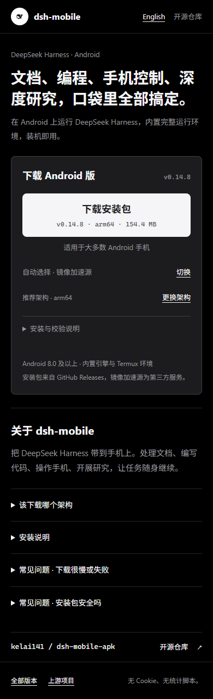
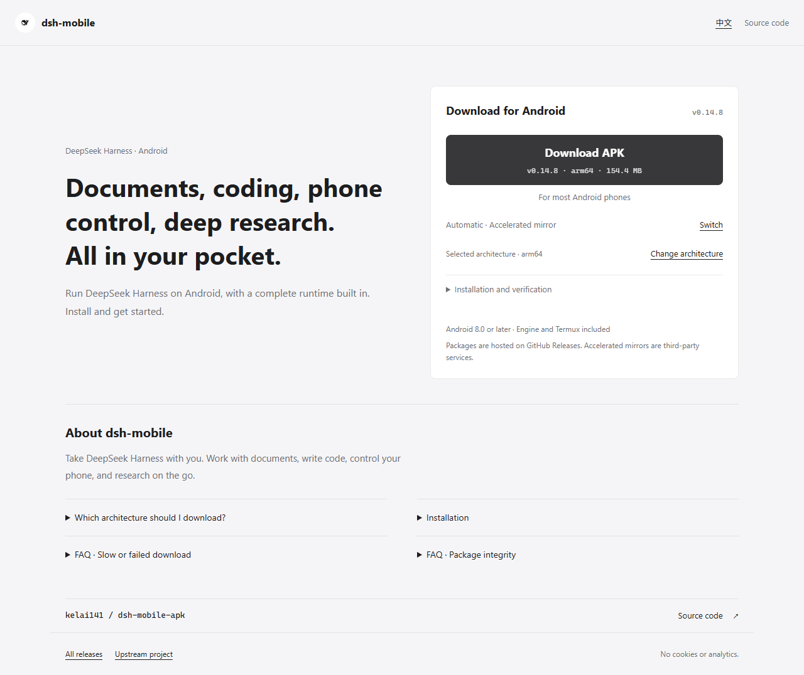

# 下载站紧凑布局与静态发布同步

## 现象与真因

手机页的四个线路药丸占用较长页面；相同版本、来源和架构在多处重复。浏览器仍会后台调用 GitHub API，而仓内离线清单停留在旧版。Pages 构建遇到 API 失败时静默使用旧清单，可能把旧版本重新部署出去。

## 修改

- 首屏使用功能 slogan；合并版本、架构与安装包大小。删除重复规格卡，仓库入口下移。
- 两类来源收进紧凑切换入口，默认自动路由。手动选择只固定类别，镜像内部自动选节点。超时不禁用来源，下载不等待探针。
- 页面中英文即时切换。始终提供架构切换和文件校验；无 JS 时仍有真实下载直链。
- 删除浏览器 API 版本请求，普通构建完全离线。CI 显式刷新公开正式版，并核对官方 MANIFEST 的双 ABI 校验值、唯一条目及字节数；失败拒绝部署。
- release 在 publish 后显式调用 Pages；草稿公开时再次刷新。所有触发都从默认分支源码读取当前公开正式版，避免旧发布事件回退版本。

- actionlint 发现发布 workflow 缓存键对常量调用了无参数 `format()`，已移除多余调用，缓存输入不变。

## 复验证据

- actionlint 校验修改过的三条 workflow 通过；状态登记与代码地图门禁通过。
- `node webpages/tools/build.mjs --self-test`：40 项代码回归与受控负控通过。API 失败、清单损坏时刷新退出 1，上一份构建产物仍保持完整。
- `node webpages/tools/build.mjs --refresh`：实际同步 v0.14.8 的两个 APK、字节数和 SHA-256；普通离线构建通过。
- 真实 Edge 浏览器测试六组：390×844 中暗色、390×844 英浅色、320×700 中暗色、844×390 英暗色、1280×800 中暗色及英浅色。
- 六组均无横向溢出，下载按钮在首屏内，折叠线路入口为 48 px。自动路由、官方与镜像手动切换、架构切换、语言切换保留目标、展开 SHA-256 及原生下载事件的目标地址全部通过，页面 API 请求数为 0。
- 浏览器负控：官方与两个镜像返回 403，只有剩余镜像成功，自动路由正确选中成功节点；所有外部请求失败时仍有下载入口，无来源被禁用。
- 禁用 JavaScript 后，构建 HTML 保留两个固定版本 APK 直链。网络行为用受控响应验证，未将其写成实际镜像可用性保证。
- 未做设备验证。本轮只改独立下载网页和部署流程，不改 APK、快照、插件或桥协议。未触发整条 APK 发布链；合并后核对实际 Pages 部署。

## 截图

